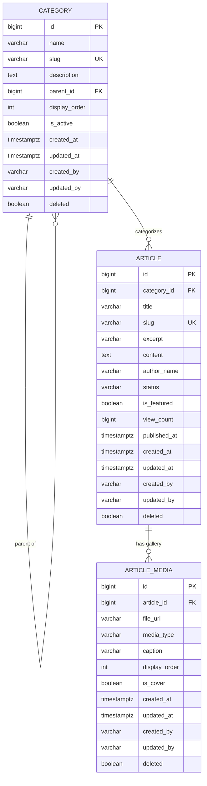

# INB Public Portal - Backend API

Core backend microservice for the General Department of Information and Broadcasting (INB)
public-facing portal and Content Management System (NICH_MoI Project). Serves news articles,
categories, and media galleries via a RESTful API for both the citizen-facing Public Portal
(read-only) and the Back Office Administration Portal (authenticated CRUD).

## 1. Feature Overview

This service implements the **first vertical slice** of the NICH_MoI platform: a News/Article
CMS module, modeled directly from the existing UX/UI (not the minimal spec in the original
README brief, which only covered `title`/`content`/`author` - see "Design Decisions" below).

| Capability | Public Portal | Back Office |
|---|---|---|
| Browse category tree / nav menu | ✅ `GET /api/public/categories` | ✅ full CRUD |
| List published articles (paginated, filterable by category) | ✅ | ✅ (any status, plus search) |
| View a single article (increments view count) | ✅ | ✅ |
| Create / edit / publish / archive articles | ❌ | ✅ (JWT + RBAC) |
| Upload gallery images | ❌ | ✅ (JWT + RBAC) |

## 2. Architecture

```
┌─────────────────────┐        ┌──────────────────────────────────────────────┐
│  Public Portal (Web) │──GET──▶│  /api/public/**   (no auth)                   │
└─────────────────────┘        │                                                │
                                │        Controller → Service → Repository      │
┌─────────────────────┐        │                       ↓                        │
│  Back Office (Admin) │──JWT──▶│  /api/admin/**    (JWT + RBAC)                │
└─────────────────────┘        │                                                │
                                │              PostgreSQL 15 (Flyway-managed)   │
                                └──────────────────────────────────────────────┘
```

Public and admin controllers are kept in separate packages
(`controller.publicapi` / `controller.admin`) with independent security rules, sharing the same
domain/service layer. This means the two can be split into standalone microservices later
(per the target Clean Architecture / microservices design) without touching business logic.

## 3. Database Design (ERD)



## 4. Design Decisions & Assumptions

The original brief specified a flat `Article{title, content, author}`. Reviewing the actual
UX/UI screenshots showed the real requirement is richer, so the following was added - flagged
here for your team's sign-off:

1. **Category is a first-class, self-referencing entity** (not a string) - supports the nested
   dropdown navigation seen in the site header.
2. **Articles support a media gallery** (`ArticleMedia`, one-to-many) - matches the
   "+14 / +4 / +8" thumbnail overlays seen on the homepage and news grid.
3. **`author` is a display-only string** (`author_name`), not a FK to a user account - the
   Auth/Identity microservice doesn't exist yet. The real acting user is tracked separately via
   `created_by` / `updated_by` audit columns. When the Auth service ships, `author_name` can
   remain as the public byline while admin UIs additionally show the real editor from audit data.
4. **This service exposes both public reads AND admin writes** (your team's explicit choice) -
   secured via JWT + `@PreAuthorize` role checks, in separate controller packages so the write
   side can be extracted into a dedicated Back Office service later with no domain-layer changes.
5. **IDs are `Long` (BIGSERIAL), not UUID** - public content is addressed by SEO-friendly slugs
   in URLs, so sequential internal IDs cost nothing and keep joins/indexes cheaper.
6. **Files are stored on local disk for now** via a `FileStorageService` interface -
   `LocalFileStorageServiceImpl` today, swappable for a `MinioFileStorageServiceImpl` later with
   zero changes to controllers/services (Dependency Inversion).

## 5. Tech Stack

- Java 21, Spring Boot 3.3.4, Spring Security, Spring Data JPA / Hibernate
- PostgreSQL 15+, Flyway (schema is Flyway-owned; `ddl-auto: validate`, never `update`)
- Lombok, MapStruct (DTO mapping), JJWT (JWT validation)
- springdoc-openapi (Swagger UI)
- JUnit 5, Mockito, AssertJ, H2 (test-only), Spring Security Test

## 6. Prerequisites

- JDK 21 ([Amazon Corretto](https://aws.amazon.com/corretto/) recommended)
- Maven 3.8+ (or your IDE's bundled Maven)
- Docker Desktop (for local PostgreSQL)

## 7. Local Development Setup

### 7.1 Start the database

```bash
docker-compose up -d
```

Maps to `localhost:5433` (not the default 5432) to avoid clashing with any native Postgres
install. DB: `inb_portal_db` / user: `inb_user` / password: `MOI@123` (dev only - see Security
notes below on secrets management for non-local environments).

### 7.2 Run the application

```bash
mvn spring-boot:run
```

Or run `InbPortalApplication.java` directly from your IDE. Flyway will run migrations
automatically on startup (`V1`-`V4`), including seed categories that match the current UI.

Server runs on **port 8085**. Swagger UI: http://localhost:8085/swagger-ui.html

### 7.3 Run tests

```bash
mvn test
```

Tests run against an in-memory H2 database (`application-test.yml`) - no Docker required for
the test suite.

### 7.4 Generating a local JWT for testing admin endpoints

Until the Auth microservice exists, generate a token with any JWT library signed with the same
`app.jwt.secret` as `application.yml` (default dev secret is in that file - **replace via the
`JWT_SECRET` env var in any shared/deployed environment**). The token must include:

```json
{
  "sub": "editor1",
  "roles": ["EDITOR"]
}
```

## 8. API Reference

All responses use a consistent envelope:
```json
{ "success": true, "message": "...", "data": { ... }, "timestamp": "..." }
```
Paginated `data` fields use: `{ content, pageNumber, pageSize, totalElements, totalPages, first, last }`.

### Public (no auth)

| Method | Path | Description |
|---|---|---|
| GET | `/api/public/categories` | Active category tree (for nav menu) |
| GET | `/api/public/categories/{slug}` | Single category |
| GET | `/api/public/articles?categoryId=&page=&size=` | Published articles, paginated |
| GET | `/api/public/articles/{slug}` | Single published article (increments view count) |

**Sample: `GET /api/public/articles/welcome-to-the-inb-portal`**
```json
{
  "success": true,
  "message": "Request completed successfully",
  "data": {
    "id": 12,
    "title": "Welcome to the INB Portal",
    "slug": "welcome-to-the-inb-portal",
    "excerpt": "Official announcement...",
    "content": "<p>Official content goes here.</p>",
    "authorName": "System Admin",
    "status": "PUBLISHED",
    "featured": true,
    "viewCount": 143,
    "publishedAt": "2026-07-18T09:00:00+07:00",
    "category": { "id": 1, "name": "ព័ត៌មានជាតិ", "slug": "national-news", "parentId": null, "displayOrder": 10, "active": true },
    "media": [
      { "id": 45, "fileUrl": "http://localhost:8085/files/abc123.jpg", "mediaType": "IMAGE", "caption": null, "displayOrder": 0, "cover": true }
    ]
  },
  "timestamp": "2026-08-04T10:15:00Z"
}
```

### Admin (JWT required, roles noted)

| Method | Path | Roles | Description |
|---|---|---|---|
| GET | `/api/admin/categories` | ADMIN, EDITOR | List all categories |
| POST | `/api/admin/categories` | ADMIN | Create category |
| PUT | `/api/admin/categories/{id}` | ADMIN | Update category |
| DELETE | `/api/admin/categories/{id}` | ADMIN | Soft-delete category |
| GET | `/api/admin/articles?status=&categoryId=&search=&featured=` | ADMIN, EDITOR | Search articles, any status |
| POST | `/api/admin/articles` | ADMIN, EDITOR | Create article (starts as `DRAFT`) |
| PUT | `/api/admin/articles/{id}` | ADMIN, EDITOR | Update article |
| PATCH | `/api/admin/articles/{id}/status?status=PUBLISHED` | ADMIN, EDITOR | Change editorial status |
| DELETE | `/api/admin/articles/{id}` | ADMIN | Soft-delete article |
| POST | `/api/admin/media/upload` (multipart) | ADMIN, EDITOR | Upload a file, get back its URL |

**Sample: `POST /api/admin/articles`**
```json
{
  "categoryId": 1,
  "title": "Welcome to the INB Portal",
  "excerpt": "Official announcement...",
  "content": "<p>Official content goes here.</p>",
  "authorName": "System Admin",
  "featured": true,
  "media": [
    { "fileUrl": "http://localhost:8085/files/abc123.jpg", "mediaType": "IMAGE", "displayOrder": 0, "cover": true }
  ]
}
```

## 9. Validation Rules

- `Category.name`: required, max 255 chars. `slug`: auto-generated from `name` if omitted,
  auto-uniquified with a numeric suffix on collision.
- `Article.title`: required, max 500 chars. `content`: required. `excerpt`: max 1000 chars.
  `categoryId`: required, must reference an existing, non-deleted category.
- File uploads: max 10MB, restricted to `jpg/jpeg/png/gif/webp/mp4/pdf` by extension (see
  known limitation below).

## 10. Known Limitations / Next Steps

- **File-type validation is extension-based only.** For a government-facing system, this should
  be hardened with content-sniffing (magic-byte / MIME detection, e.g. Apache Tika) before
  production launch - extension checks alone can be spoofed.
- **No rate limiting yet** on public endpoints - add at the API Gateway layer.
- **JWT is validation-only**; this service does not issue tokens. Wire up to the real Auth
  microservice once it exists; until then use manually-signed test tokens (see §7.4).
- **Full-text search** currently uses a simple `LIKE` + a `tsvector` index on `title` only;
  swap for Elasticsearch when that infrastructure lands, per the platform's future-tech roadmap.
- **No Menu/static-page module yet** - the `Category` tree currently doubles as the nav
  structure. If "About Us" / other dropdown items need non-article content, that likely warrants
  a dedicated `Page` entity in the next slice.
- **Build verification**: this project was scaffolded and manually reviewed for structural
  correctness (brace balance, Lombok/MapStruct annotation conflicts, JPA Criteria API typing),
  but has **not yet been compiled with a live `mvn install`** in this environment due to sandbox
  network restrictions (Maven Central unreachable). **Run `mvn clean install` locally as the
  first step** before relying on this build.

## 11. Project Structure

```
src/main/java/gov/kh/moi/inb/
 ├── config           # Security, CORS, JPA auditing, static file serving, OpenAPI
 ├── controller
 │    ├── publicapi    # Unauthenticated read endpoints
 │    └── admin         # JWT-protected write endpoints
 ├── dto
 │    ├── request
 │    └── response
 ├── entity            # JPA entities
 ├── exception         # Global exception handling
 ├── mapper            # MapStruct entity <-> DTO mappers
 ├── repository
 │    └── spec          # JPA Specifications for dynamic filtering
 ├── security          # JWT filter + token provider
 ├── service
 │    └── impl
 └── util
src/main/resources/db/migration   # Flyway SQL migrations (V1-V4)
```
